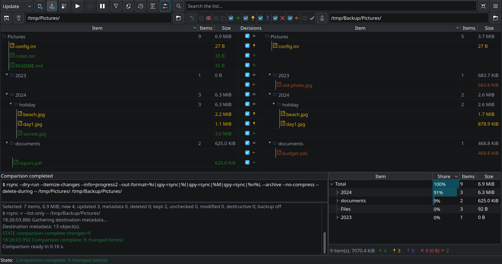
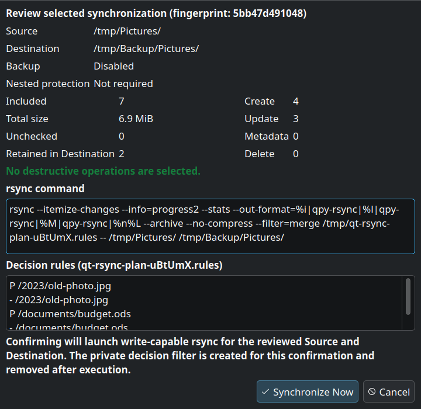
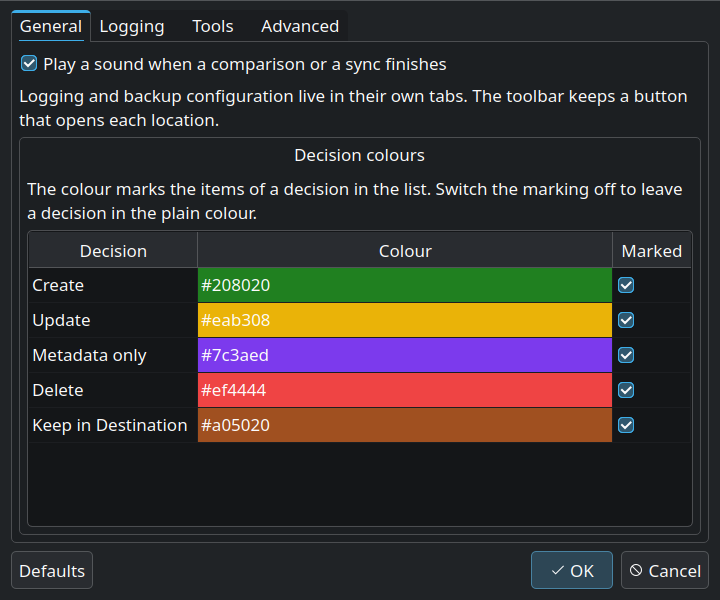

# qt-rsync

`qt-rsync` is a graphical frontend for `rsync` for the Linux desktop, written
in pure Qt 6 and C++20. It is a direct port of
[qpy-rsync](https://github.com/eugenesan/qpy-rsync): the same decision
semantics, execution plan, filter rules, rsync command construction, profiles
and UI model, with **no Python runtime and no second internal state**.

It compares two locations with a real `rsync --dry-run`, shows what would
change in a flat, sortable list, lets you decide item by item what to do, and
only writes after you have reviewed the plan and confirmed it. Every command
stays inspectable and no file is touched without a preview.



## What it does

- compares a local folder with another local folder, or with one folder on a
  remote host over SSH
- shows the source, the decision and the destination of every item in one flat
  list, with the folders painted as a hierarchy
- lets you include or exclude items, whole folders or a whole comparison
- excludes items for the duration of one comparison, and folds folders away
  while you read a large tree
- keeps one ordered list of rsync include and exclude rules, with a live
  preview of the command
- takes a backup of everything it changes, in a directory you choose
- optionally verifies the selection with a second dry run, and asks for an
  explicit confirmation before it writes anything
- reports the progress, keeps a journal of every command, and logs the raw
  rsync output in a session file
- opens an item in an external diff tool, or in any external tool you
  configure
- summarizes the folders in an overview with item counts, sizes, shares and the
  same decisions as the list
- keeps one C++ decision store and one comparison dataset; the views only
  project them

## Using it

### 1. Enter the two locations

Both fields accept the same syntax:

```text
/home/alice/data          a local folder
~/data                    a local folder, ~ is expanded
server:/srv/data          a folder on a remote host
alice@server:/srv/data    a folder on a remote host, with a user
```

At most one side may be remote. `Host` aliases from `~/.ssh/config` work as
they do for `rsync`. Press **Enter** in the destination field to start the
comparison when both sides are filled in.

### 2. Choose the method

| Method | Behaviour |
|---|---|
| **Update** | copies new and changed items, keeps what only exists in the destination |
| **Mirror** | makes the destination match the source, deleting the items that only exist there |
| **New Only** | copies only the items that are missing in the destination |

Changing the method after a comparison marks it stale, disables Sync/Verify
and badges Compare until a fresh comparison. **Preserve Decisions** stays as
you set it.

### 3. Compare

**Compare** (F5) runs `rsync --dry-run`. The list fills with the items that
rsync reported, grouped by folder. The three panes stay synchronized: the
source on the left, the decision in the middle, the destination on the right.

The decision pane carries a checkbox for every item that can be decided.
Checking an item includes it in the synchronization, unchecking it excludes
it. A folder decides for everything below it, and a child can override its
folder. The **Preserve Decisions** button beside Compare keeps manual
decisions across the next comparison.

### 4. Filter, fold and exclude

The filter field above the panes matches the names of the items, or their
relative path when the pattern contains a slash. Shell-style globs work
(`*.jpg`, `file?.txt`, `[0-9]*`). A pattern that ends with a slash matches
the folder with that name exactly, and retains its complete subtree.

```text
guide        matches names containing "guide"
*.py         matches Python filenames
file?.txt    uses ? for one character
[0-9]*       matches names beginning with a digit
*            shows all changed objects
.            matches names containing a literal period
docs/        matches the docs folder exactly and retains its subtree
```

The branch marker in front of a folder folds its contents out of the list.
Folding is a view-only operation: the synchronization, the totals and the
overview keep every item.

**Space** excludes the selected item. An excluded item is left out of the
synchronization, stays in the comparison so that you can restore it, and is
forgotten with the next comparison. The crossed-eye marker in the decision
column excludes and includes an item, the *Show excluded items* toggle in the
filter bar reveals them, and its right-click menu offers *Reset All
Exclusions*.

The checkboxes above the panes filter the list by decision. A plain click
toggles one decision, **Ctrl+click** inverts the bar so that only the clicked
decision is shown, and the right-click menu of a checkbox offers *Show only
this*, *Show everything but this*, *Show all* and *Reset to default*. The
folder toggle next to them applies the same filters to reported directories:
off, directories ignore the decision filters; on, a directory whose own
change is filtered out stays as a faded parent when it still contains visible
items.

### 5. Verify and synchronize

**Verify Decisions** (F8) builds an immutable plan of your selection and runs
a second dry run with it. If the result differs from what you see, the
execution is blocked and the difference is reported. Verification is optional
and its toolbar button is hidden until **Settings → Advanced** enables the
verification controls.

**Synchronize** (F9) opens the confirmation dialog with the endpoints, the
counts, the destructive operations and the backup configuration. Only after
you confirm, a write-capable `rsync` runs with the verified plan. The
comparison is then marked stale; it is up to you to press Compare when you
want a fresh view, so the journal still shows what the sync just did.



### Overview

The overview summarizes the comparison by folder. **Total** carries the whole
selection, the synthetic **Files** row lists the objects that live in the
compared folder itself, and every folder shows its items, size and share of
its parent. A reported directory counts as one item of its parent; synthesized
navigation folders and faded, filtered-out parents do not. The overview follows
the same decision filters as the list, starts collapsed, and sorts by share by
default. Click the **go-jump** icon to the left of a folder to reveal it in the
comparison panes; a normal click still selects and expands the folder.
Press **Space** on a folder to exclude it, or use its right-click menu to
exclude, restore, or add an rsync filter. **Ctrl+Tab** cycles Normal, Compare
only and Compare with overview.

### Filters, backups and profiles

- **Filters** (F7) maintains the ordered include and exclude rules. The first
  matching rsync rule wins, and the rules apply to the comparison and to the
  execution.
- The **backup directory** turns on rsync's `--backup` for everything that is
  changed or removed on the destination. When the backup folder lies inside
  the compared tree, it is protected automatically.
- **Save Profile** (F2) and **Load Profile** (F3) store the endpoints, the
  method, the rules and the backup settings. Profile locks prevent two
  instances from writing the same profile at once.

### External tools

The settings have a *Tools* page that lists the tools the context menu of a
row offers. A tool is a command with placeholders:

| Placeholder | Meaning |
|---|---|
| `%a` | the full path of the item in the pane you clicked |
| `%f` | its file name, `%x` its extension, `%b` the name without it |
| `%d` | its directory |
| `%A` | the full path of the item in the other pane |
| `%F` | its file name, `%X` its extension, `%B` the name without it |
| `%D` | its directory |
| `%R` `%U` `%V` `%W` `%P` | the host, the user, `@`, `:` and `://` of the other pane |
| `%T` `%O` | the name and the options of the tool |
| `%%` | a literal percent |

```text
kate %d/%f
meld %D %d
scp %d/%f %U%V%R%W%D/%F
```

The same page holds the command of the diff tool. An empty field keeps the
tool that the system offers, with the preference of Git.



### Keyboard

| Key | Action |
|---|---|
| F1 | the how-to |
| F2 / F3 | save and load a profile |
| F4 | edit the profile |
| F5 / F6 / F7 | compare, inventory, filters |
| F8 / F9 | verify the decisions, synchronize |
| F10 / F11 | cancel a running operation, pause it |
| F12 | cycle the synchronization method |
| Ctrl+F | focus the filter field |
| Ctrl+G / Ctrl+Shift+G | find next / previous |
| Ctrl+S / Ctrl+D / Ctrl+N / Ctrl+W | focus the Source / Destination / Decisions / Overview pane |
| Ctrl+[ / Ctrl+] | focus the Source / Destination location field (Esc ends editing) |
| Alt+1..8 / Ctrl+1..8 | click / invert a decision filter; 9 is the directory filter |
| Ctrl+Tab / Ctrl+Shift+Tab | next / previous layout |
| Ctrl+, | the settings |
| Ctrl+Z / Ctrl+Shift+Z | undo / redo a decision |
| Space | exclude the selected item |
| Home / End | jump to the first / last visible item |
| Ctrl+Up / Ctrl+Down | jump to the parent / first child |
| Left / Right | fold/unfold a folder, then move to its parent / first child |
| Ctrl+click | invert the decision filter |
| Esc | clear the filter field, or end editing in a location field |
| Ctrl+Q | quit |

## Requirements

- Linux
- Qt 6.5 or newer (Core, GUI, Widgets)
- CMake 3.20 or newer, Ninja and a C++20 compiler
- rsync 3.x
- OpenSSH for the remote endpoints
- `setsid` from util-linux for remote operations
- an askpass helper (`ksshaskpass`) for the password prompts of a remote host
- optionally, KDE Breeze for the matching desktop appearance

## Build

```sh
./build.sh                       # builds into ./build (or $QT_RSYNC_BUILD_DIR)
./build/bin/qt-rsync --help
./test.sh                        # configure, build and run all QtTest cases
```

`build.sh` accepts extra CMake arguments, for example
`./build.sh -DQT_RSYNC_BUILD_TESTS=OFF`.

Install the binary, desktop entry and icon with:

```sh
cmake --install ./build --prefix /usr/local
```

`./build/bin/qt-rsync --version` includes the checkout commit, so a shared
binary can be identified.

### Command line options

There is one executable, `qt-rsync`; startup options are carried over from the
qpy-rsync GUI launcher, and unrecognised arguments are forwarded to Qt.

| Option | Meaning |
|---|---|
| `--dir-pair SOURCE DESTINATION`, `-d` | Populate Source and Destination. Required with `--compare`. |
| `--backup DIRECTORY` | Populate the backup directory. |
| `--mode MODE` | `update` (default), `mirror` or `new-only`. |
| `--compare` | Start a comparison once the event loop initializes. |
| `--log-file PATH` | Override the persistent session log path. |
| `--no-log-file` | Disable persistent session logging for this launch. |
| `--version` | Print version and build, then exit. |
| `--help` | Print usage. |

`--log-file` and `--no-log-file` are mutually exclusive.

## Debian package

```sh
dpkg-buildpackage -us -uc -b -d
sudo apt install ../qt-rsync_0.2.1-0_amd64.deb
```

The package installs `/usr/bin/qt-rsync`, the desktop entry and the scalable
icon. It depends on Qt 6 and rsync; KDE Breeze and `ksshaskpass` are
recommended.

## Layout

```text
src/app/     entry point, CLI parsing, XDG/Qt environment setup
src/core/    domain: changes, decisions, filters, plan, command, parser, storage
src/model/   Qt item models over one C++ DataStore (lifted from native-hybrid)
src/ui/      main window, comparison panes, overview, settings, dialogs
resources/   icon, desktop entry and README screenshots
tests/       QtTest suite (core + UI)
docs/        architecture decisions, code map and testing notes
```

## Design constraint

There is exactly one decision store and one comparison dataset, both owned in
C++. The UI models only project them. This is the central lesson from the
qpy-rsync hybrid phase and is documented in ADR-002
([`docs/decisions.md`](docs/decisions.md)).

### Differences from qpy-rsync

- Pure C++20 / Qt 6 Widgets: no Python runtime, no headless CLI, no QML or
  `.ui` files, and no Python/native dual view.
- qt-rsync-native XDG paths; qpy settings and profiles are neither imported
  nor migrated. Profiles are JSON, settings are plain INI values (no base64).
- Byte-size columns 9/10 are hidden by default; recent profiles are ordered by
  modification time; timing diagnostics go to the session log and stderr, not
  to a separate perf-log file.
- The test-level N/A list is in [`docs/testing.md`](docs/testing.md).

## Documentation

| Document | Content |
|---|---|
| [`docs/code-map.md`](docs/code-map.md) | where each class, model, dialog and rule lives |
| [`docs/decisions.md`](docs/decisions.md) | the architecture decisions, including ADR-002 |
| [`docs/testing.md`](docs/testing.md) | test commands, oracle strategy and deliberate differences |
| [`CHANGELOG.md`](CHANGELOG.md) | the history of every change |

Detailed product specifications, performance research and the native-view
experiment remain in the [qpy-rsync repository](https://github.com/eugenesan/qpy-rsync)
(`docs/design.md`, `docs/installation.md`, `docs/debugging.md`,
`docs/performance-analysis.md`, `native-hybrid/README.md`,
`native-qt-model/CONCLUSION.md`) and are not duplicated here. For Qt, the
equivalent host/SSH setup and build instructions are in **Requirements**,
**Build** and **Debian package** above.

## Safety status

qt-rsync is a young release. Synchronization is tested against disposable
trees, mirror-mode deletions and filtered transfers. The explicit confirmation,
the optional second dry run and the profile locks stand between a comparison
and a write, and the application never runs a command through a shell.

## License

GPL-3.0-or-later. See [`LICENSE`](LICENSE).
